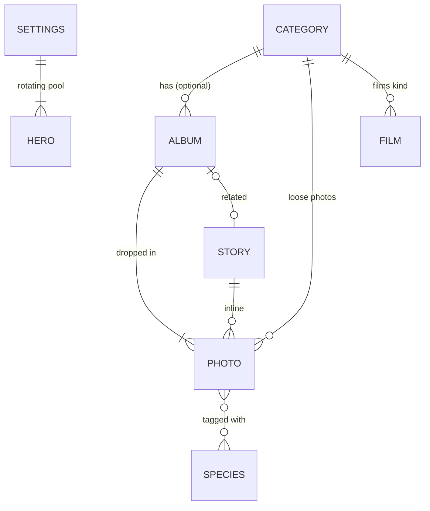

# Content model (Sanity)

Status: agreed 2026-11-18. This is what you fill in inside Sanity Studio, and what the site computes for you.

## At a glance

- **Categories are yours to manage** — add, rename, reorder or delete them; the dial follows.

- **Photos live inside an album** (or directly in a category, for loose photos). You drag a whole trip's photos into the album at once; each one becomes its own photo entry with its own page and URL.
- **Species** come from a managed list, so counts and filters stay accurate.
- **Locations** are optional free text. Filled in → shown. Empty → hidden.
- **Camera GPS is never published** (see Safety).

## Documents you edit

### Site settings (one, fixed)

| Field | Type | Notes |
|---|---|---|
| Site title, tagline | text | Used in titles and the hero |
| SEO description | text | Default meta description |
| Social image | image | Default share preview |
| **Hero pool** | list of hero items (3–6) | One is picked per visit; used by the Focus-pull intro |
| ↳ image | image + **hotspot** | Tap the subject in Studio — that's where the focus brackets lock |
| ↳ species / location | text, optional | Shown in the hero readout |
| ↳ link | album | Where "view" goes |
| **Featured frame** | photo + story text + link | The home page's featured section |
| Socials | Instagram URL, YouTube URL | Footer, About |

### Category (add, edit, delete freely)

Starts with Wildlife · Street · Astrophotography · Concert · Filmmaking. Add more (e.g. Macro, Landscape) or remove any; the dial, home tiles, footer, sitemap and journal filters all update on the next publish.

| Field | Type | Notes |
|---|---|---|
| Title, slug | text | `/wildlife/` etc. Changing a slug later breaks old links, so Studio warns you |
| Dial code | 2 letters, unique | WL, ST, AS… — what the dial shows. AUTO is reserved |
| Dial order | number (1, 2, 3…) | Position on the dial (clockwise after AUTO) and order of home tiles |
| Kind | Photos / Films | Films categories list films instead of albums (Filmmaking) |
| Main category | yes/no, only one | Gets the "main" badge and drives the trips counter (Wildlife) |
| Intro | text | The 2-line description on the category page (SEO) |
| Cover | image | Home category tile |
| Loose photos | list of photos | Photos that don't belong to any album (Photos kind) |
| SEO title / description | text, optional | Falls back to title + intro |

- **Deleting:** Sanity won't delete a category that still has albums, films or stories pointing at it; it lists them so you can move or delete them first. Nothing breaks silently.
- **Dial limit:** up to **8 categories** (+ AUTO = 9 positions, 40° apart). Beyond that the dial's labels get too cramped to tap; Studio blocks a 9th. We can revisit if you ever need more.

### Album (a trip, a show, a night out)

| Field | Type | Notes |
|---|---|---|
| Title, slug | text | `/wildlife/<album>/` |
| Category | a Photos-kind category | Required |
| Location | text, optional | e.g. "Tadoba, Maharashtra" — shown only if filled |
| Dates | start, end (optional) | Sorts albums newest first |
| Description | text | Album intro (SEO) |
| Cover | tick “Use as album cover” on a photo | Defaults to the first photo |
| **Photos** | list — drag many in at once | Reorder by dragging |
| Related story | journal story, optional | "From the journal" card |

### Photo (inside an album or category)

| Field | Type | Notes |
|---|---|---|
| Image | image | EXIF and blur placeholder read automatically |
| **Alt text** | text, **required** | What's in the photo — accessibility and image SEO |
| Title | text, optional | Falls back to species, then album name |
| Web address | automatic | `/wildlife/<album>/<photo>/`, made from the title/species plus a short stable code — nothing to type |
| Caption / story | short text, optional | Shown in the HUD |
| Species | pick from list, optional (many) | Wildlife mainly; feeds stats and filter chips |
| Location | text, optional | Overrides the album's location if set |
| Taken on | date | Auto-filled from the camera, editable |
| Gear override | camera / lens text, optional | Only if EXIF is missing (manual lens, phone) |

Shutter, aperture, ISO, focal length, camera and lens are **read from the file** — you never type them.

### Species

| Field | Type | Notes |
|---|---|---|
| Common name | text | Bengal tiger |
| Scientific name | text, optional | *Panthera tigris tigris* |
| Group | mammal / bird / reptile / amphibian / insect / other | Optional, for future filtering |

Add a new species straight from a photo's species picker.

### Journal story

| Field | Type | Notes |
|---|---|---|
| Title, slug | text | `/journal/<story>/` |
| Category | any category, optional | Journal filter chips |
| Cover | image | |
| Standfirst | text | One- or two-sentence summary |
| Body | rich text | Paragraphs, headings, pull quotes, single photo, photo pair, video embed |
| Published on | date | |
| Related album | album, optional | "See all photos from this trip" |

Reading time is calculated automatically.

### Film

| Field | Type | Notes |
|---|---|---|
| Title, slug | text | |
| Category | a Films-kind category | Filmmaking by default |
| Video link | YouTube or Vimeo URL | Player loads only on click |
| Poster | image, optional | Falls back to the platform thumbnail |
| Description | text | |
| Year, length, role, format | text, optional | Shown only if filled |
| Featured | yes/no | The big film at the top of /film |

### About (one, fixed)

| Field | Type | Notes |
|---|---|---|
| Portrait | image | |
| Short bio | text | Two lines for the home page strip |
| Bio | rich text | **Photography only** — no developer content |
| Based in | text, optional | |
| Gear | list of { kind: Body / Tele / Wide / Misc, name } | Also used on the home page strip |
| Editing software | text, optional | |

## Computed by the site (nothing to type)

| What | How |
|---|---|
| Species count | Distinct species across all photos |
| Trips | Number of albums in the main category |
| Places | Distinct filled-in album locations |
| Frames | Total photos |
| Dial positions | AUTO + your categories in dial order, spaced evenly |
| Dial state | From the page's category; AUTO on Home, Journal, About |
| EXIF readout | From each photo file |
| Reading time | From story length |
| Sitemap, image sitemap, JSON-LD | From all of the above |

## Studio layout

Site settings & home (hero pool, featured frame) · Categories (sorted by dial order) · Albums (all, or by category) · Journal · Films · Species · About

Validation: alt text required; an album needs at least one photo before publishing; slugs and dial codes must be unique; at most 8 categories and exactly one main category.

## Publishing

Publish in Studio → Sanity webhook → Vercel deploy hook → site rebuilt in about a minute. Saving a draft does nothing to the live site.

## Safety

- The site only ever serves resized copies from the image CDN; original files are never linked.
- Camera GPS is not requested from Sanity's metadata and is never shown. During the build we'll confirm the served images carry no GPS data.

## SEO mapping

| Content | Structured data |
|---|---|
| Photo page | `ImageObject` (creator, copyright, caption) |
| Album / category | `ImageGallery` + `BreadcrumbList` |
| Story | `Article` |
| Film | `VideoObject` |
| About | `Person` — name, socials only (no job title or employer) |

## Later

- Lightroom export (README → Further improvements) writes albums and photos through Sanity's API, using this same model.
- Species pages (`/wildlife/species/<name>/`) can be added later from the species list with no content changes.
